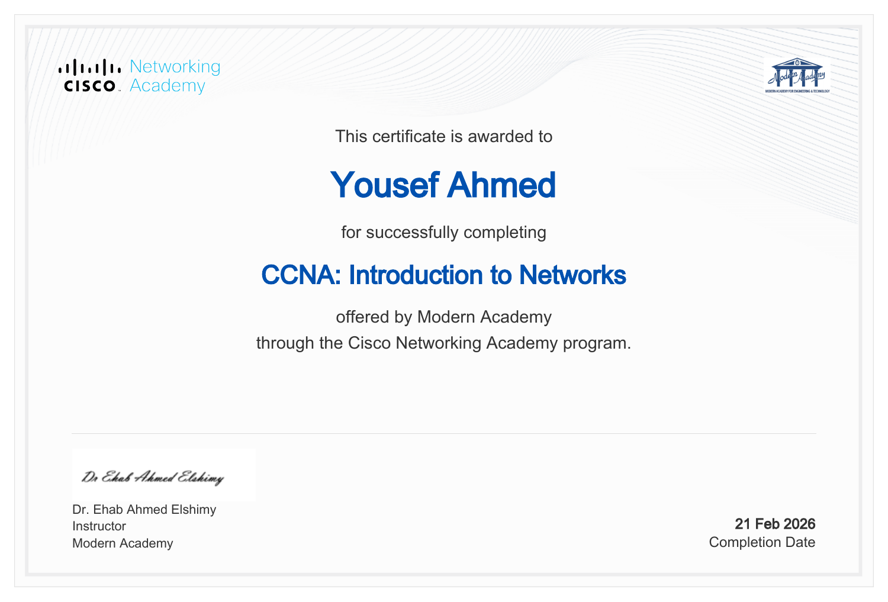
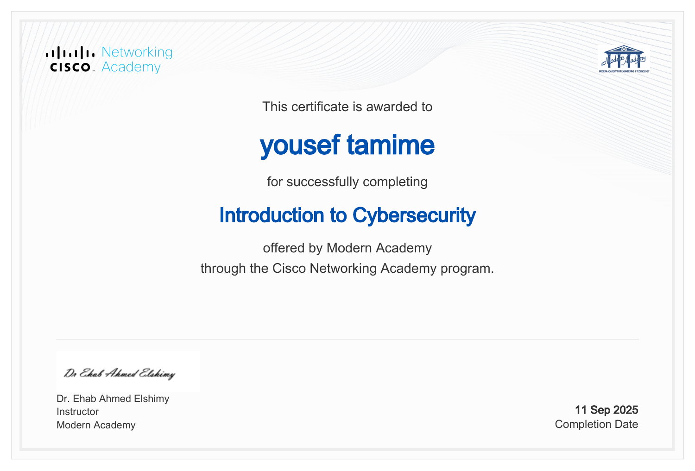
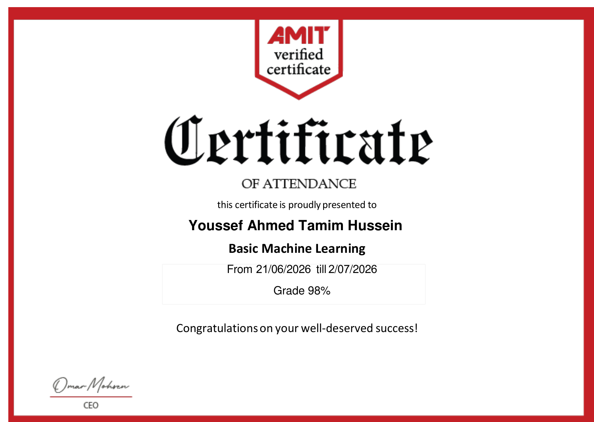

# Yousef Tamime

Computer Engineering student focused on cybersecurity, networking and blue-team defense.

## Certificates

### Cisco Networking Academy: CCNA: Introduction to Networks
CCNA1 course completion.

[View certificate](https://www.netacad.com/certificates/?issuanceId=bfbe5903-0b45-4ec0-82bd-4a9e3a8f2ead)

### Cisco Networking Academy: Introduction to Cybersecurity

[View certificate](https://www.netacad.com/certificates/?issuanceId=3939804a-b1ec-431d-a984-865d30ffd6c4)

### AMIT: Basic Machine Learning

## Projects
- [Bank Deposit Predictor](https://github.com/youseftamime/project): a Python and Streamlit app using a Random Forest model.
